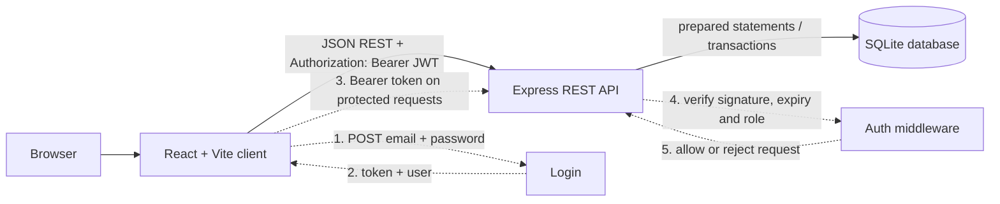
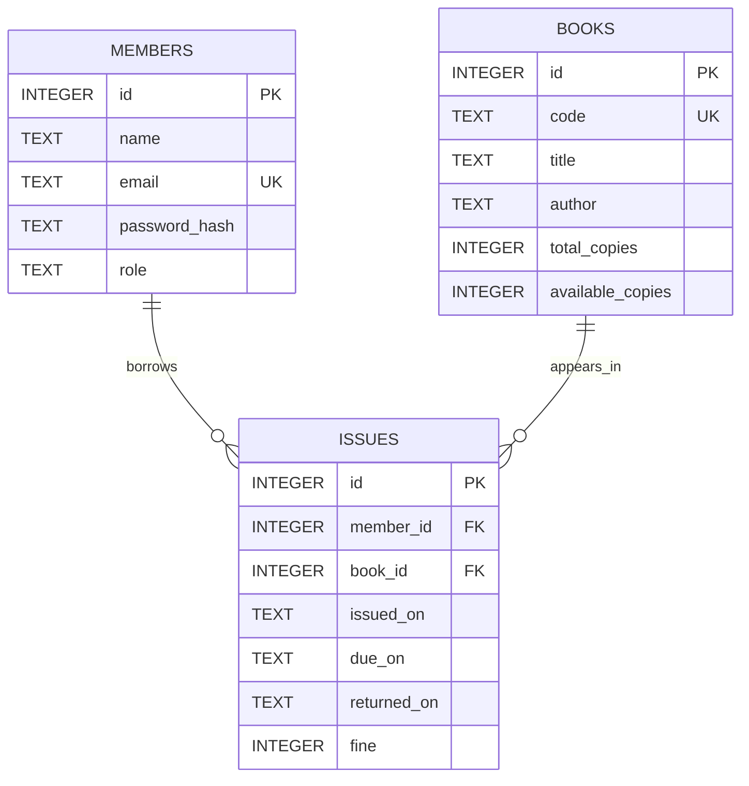

# BookNest — Library Tracker

A small, secure library catalogue and lending desk for members and librarians. The visual direction is classic and bookish: warm white paper, ink-black navigation, muted gold, serif display type and custom illustrated book covers.

## Architecture



JWTs expire after one hour and carry only the member id and role. The browser stores the token and basic user details in `localStorage`; this keeps the demo login persistent across refreshes, but JavaScript can access it, so an XSS flaw could expose it. A production deployment should prefer a carefully configured `HttpOnly`, `Secure`, `SameSite` cookie.

## Data model



The index `issues(member_id, returned_on)` speeds up (1) a member's issue-history lookup and (2) counting a member's active, unreturned issues before issuing another book.

## API

All dates are ISO `YYYY-MM-DD`; fine amounts are whole rupees. Error responses use `{ "error": { "code": "...", "message": "..." } }`.

| Method and endpoint | Access | Request body / query | Success response | Common errors |
|---|---|---|---|---|
| `POST /api/auth/login` | Public | `{ "email": "admin@lib.example", "password": "Pass@123" }` | `200 { "token": "<JWT>", "user": { "id": 1, "name": "Admin", "email": "admin@lib.example", "role": "librarian" } }` | `400 VALIDATION_ERROR`, `401 INVALID_CREDENTIALS` |
| `GET /api/books?search=&page=&limit=` | Logged in | Search and pagination in query string | `200 { "data": [{ "id": 1, "code": "LIB-1001", "title": "The Pragmatic Programmer", "author": "Hunt & Thomas", "totalCopies": 2, "availableCopies": 2 }], "page": 1, "limit": 10, "total": 5, "totalPages": 1 }` | `401 UNAUTHORIZED` |
| `POST /api/books` | Librarian | `{ "code": "LIB-1006", "title": "New book", "author": "Author", "totalCopies": 2 }` | `201 { "id": 6, "code": "LIB-1006", "title": "New book", "author": "Author", "totalCopies": 2, "availableCopies": 2 }` | `400 VALIDATION_ERROR`, `401`, `403`, `409 DUPLICATE_BOOK` |
| `POST /api/issues` | Librarian | `{ "memberId": 2, "bookId": 1 }` | `201 { "id": 2, "memberId": 2, "bookId": 1, "issuedOn": "2026-10-14", "dueOn": "2026-10-28", "returnedOn": null, "fine": 0 }` | `400 VALIDATION_ERROR`, `401`, `403`, `404`, `409 NO_COPIES` / `LIMIT_REACHED` |
| `POST /api/issues/:id/return` | Librarian | `{}` | `200 { "fine": 12 }` | `401`, `403`, `404 ISSUE_NOT_FOUND`, `409 ALREADY_RETURNED` |
| `GET /api/issues/overdue` | Librarian | None | `200 [{ "id": 1, "memberName": "Rohan", "memberEmail": "rohan@lib.example", "bookTitle": "Database System Concepts", "bookCode": "LIB-1004", "issuedOn": "2026-09-24", "dueOn": "2026-10-08", "daysOverdue": 6, "fine": 12 }]` | `401`, `403` |
| `GET /api/issues/mine` | Member | None | `200 [{ "id": 1, "bookCode": "LIB-1001", "bookTitle": "The Pragmatic Programmer", "author": "Hunt & Thomas", "issuedOn": "2026-10-14", "dueOn": "2026-10-28", "returnedOn": null, "fine": 0, "currentFine": 0 }]` | `401`, `403` |
| `GET /api/members` | Librarian | None | `200 [{ "id": 2, "name": "Aarav", "email": "aarav@lib.example" }]` | `401`, `403` |

`/api/members` is an additional librarian-only endpoint used to populate the issue form.

## Database and safety notes

- SQLite enables foreign keys; schema constraints enforce unique email/book codes, allowed roles, and non-negative/consistent copy counts.
- `server/src/db/queries.sql` contains the requested overdue-list (Q1) and top-three issued-books (Q2) queries.
- Every value originating from a request is passed as a prepared-statement parameter. Catalogue search uses literal substring matching, so SQL-looking text stays plain search text.
- Issuing and returning happen inside SQLite transactions. The conditional `UPDATE ... available_copies > 0` prevents two requests from reserving the last copy; SQLite serializes writes, so exactly one succeeds.
- Passwords are bcrypt-hashed. Seed users all use the provided lab password, `Pass@123`; only the hash is inserted.
- Role checks run after JWT authentication. Members can only access their own issue list; only librarians can view overdue issues, issue/return books, and add books.
- The fine is ₹2 per full calendar day after the due date. A same-day/on-time return incurs no fine.

## Run locally

Requires Node.js 20 or newer. From the repository root, create `.env` from `.env.example` and set a private `JWT_SECRET`.

```sh
npm ci
npm run seed
npm run dev
```

The Vite client is at `http://localhost:5173`; the API is at `http://localhost:3000`. For a production API process, run `npm start` instead of `npm run dev`. Seed credentials: `admin@lib.example`, `aarav@lib.example`, `meera@lib.example`, and `rohan@lib.example`, each with `Pass@123`.

## Tests

`npm test` runs Jest + Supertest against a fresh in-memory SQLite database for each test. The suite checks authentication, protected routes, parameterised search and pagination, last-copy overselling, the three-active-loan limit, overdue return fines, role restrictions, validation, simultaneous issue requests, and the fine-calculation unit cases.

## Container

Build from the repository root with `docker build -t booknest .`, then run with `docker run --rm -p 3000:3000 -e JWT_SECRET=<a-long-random-secret> -v booknest-data:/app/data booknest`. The image uses Node 20 Alpine, installs only server production dependencies, and runs as the non-root `node` user. Seed a persistent database before first use with `docker run --rm -e JWT_SECRET=<a-long-random-secret> -v booknest-data:/app/data booknest npm run seed --workspace server`.

## CI

GitHub Actions runs `npm ci` and `npm test` for every push and pull request.
